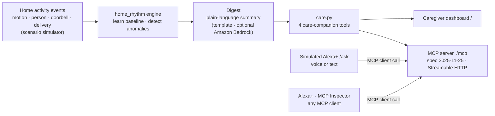

# Allswell

**Ask Alexa how Mum's day went — without ever watching her.**

## The problem

Millions of older people live alone, and the families who look after them from
a distance worry. Today's answer is usually a camera: a live feed of a parent's
kitchen. It works, but it feels like surveillance to the person being watched,
and it hands the caregiver a stream to stare at instead of an answer.

## The idea

Allswell is a **privacy-first care companion**. It reads only home-activity
*events* (motion, person, doorbell, delivery), learns the person's normal daily
rhythm, and stays quiet unless that rhythm breaks.

- The caregiver asks *"How was Mum's day?"* and hears **"All's well"**, or a
  calm, specific heads-up: no morning routine by late morning · a doorbell at
  3 AM · a delivery left unretrieved · a restless night.
- Its insights are exposed as **MCP tools**, so a voice assistant like Alexa+
  can answer from real data.
- **No live video is ever shown, collected or stored. Insights only.** Ask for
  the camera and Allswell politely declines. That privacy inversion is the
  product.

---

## Architecture



Every surface (dashboard, MCP server, simulated Alexa+) calls the same four
functions in `backend/care.py`, so they always agree.

---

## Quick start

Requires **Python 3.10+**. No API keys, no AWS account, no hardware.

```bash
git clone <your-repo-url> allswell
cd allswell
./run.sh                                          # macOS / Linux
powershell -ExecutionPolicy Bypass -File run.ps1  # Windows
```

Each script creates `.venv`, installs `requirements.txt` and starts the app.
Manual equivalent:

```bash
python -m venv .venv
.venv/bin/pip install -r requirements.txt          # Windows: .venv\Scripts\pip ...
.venv/bin/python -m uvicorn backend.main:app --port 8000
```

| Open | What it is |
|---|---|
| <http://127.0.0.1:8000/ask> | **Simulated Alexa+ experience**: ask by voice (Chrome/Edge) or text |
| <http://127.0.0.1:8000> | Caregiver dashboard |
| `http://127.0.0.1:8000/mcp` | **MCP server** (Streamable HTTP) |

Use the **Demo scenario** picker (on either page) to switch between a calm day
and each anomaly. The demo timeline is deterministic: every run looks the same.

### Test the MCP server

With the app running, use the official MCP client:

```bash
.venv/bin/python scripts/mcp_smoke_test.py      # Windows: .venv\Scripts\python scripts\mcp_smoke_test.py
```

```
connected to Allswell | protocol 2025-11-25
tools: get_day_status, get_rhythm_timeline, get_anomalies, check_in
```

Or the **MCP Inspector** (needs Node.js): run `npx @modelcontextprotocol/inspector`,
add a server with transport **Streamable HTTP** and URL `http://127.0.0.1:8000/mcp`,
connect, and run any tool from the **Tools** tab.

---

## Where the Alexa+ tech runs (eligibility)

Allswell takes **both** Alexa+ paths: a self-hosted MCP server (the real
integration) and a simulated Alexa+ experience that calls it at runtime.

| What | Where | Proof at runtime |
|---|---|---|
| MCP server built with the official SDK (`mcp==1.30.0`, MCP spec **2025-11-25**) | `backend/mcp_server.py`: `server = FastMCP(...)` and the four `@server.tool` functions | `scripts/mcp_smoke_test.py` prints the negotiated `protocol 2025-11-25` |
| Served over **Streamable HTTP** at `/mcp` | `backend/main.py`: `mcp_server.streamable_http_app()`, `lifespan()` runs `session_manager.run()`, `app.mount("/", mcp_app)` | MCP Inspector connects and runs tools |
| Simulated Alexa+ calls the MCP server | `backend/assistant.py`: `call_tool()` uses `streamable_http_client` + `ClientSession.call_tool`; reached from `POST /api/ask` (`api_ask` in `backend/main.py`) | Every question logs `POST /mcp` in the server output; each reply shows which tool was called |
| Simulation source (clearly labelled "Simulated Alexa+ experience") | `frontend/ask.html`, `frontend/ask.js` | Visible on `/ask` |

### The MCP tools

| Tool | Returns |
|---|---|
| `get_day_status(person)` | all's well / needs a look, plus the plain-language digest |
| `get_rhythm_timeline(person)` | today's events (type, room, time): metadata only |
| `get_anomalies(person)` | what broke the normal rhythm today (empty when all is well) |
| `check_in(person)` | records that the caregiver reached out (a mock call; never video) |

Read-only tools carry `readOnlyHint` annotations, and the server instructions
tell the assistant to answer only from tool results and never speculate.

---

## Hackathon entry

- **Track:** Alexa+ (care-taking), Build, Ship, Shape: Amazon Developer Hackathon.
- **Open Source mini-challenge:** `packages/home_rhythm/`, a dependency-free
  rhythm engine any home-sensor project can reuse (see below).
- **AWS Builder mini-challenge:** not entered. An optional Amazon Bedrock
  phrasing backend exists in `backend/digest.py` but is off by default and is
  not used in the demo.

---

## How it works

### The rhythm engine (`home_rhythm`)

| Rule | Fires when | Severity |
|------|------------|----------|
| `MISSING_MORNING_ROUTINE` | a reliable morning zone has no activity by the grace cutoff | critical |
| `OFF_HOURS_ACTIVITY` | motion / person / doorbell during the learned quiet window | critical / warn |
| `UNRETRIEVED_DELIVERY` | a delivery with no pickup activity within the grace window | warn |
| `REPEATED_NIGHT_ACTIVITY` | repeated night-time movement above a threshold | warn |

No ML, just rolling statistics and explainable rules, so every alert carries the
real event time and room. To reuse it, copy `packages/home_rhythm/` into any
project with timestamped home-sensor events:

```python
from home_rhythm import Event, build_baseline, evaluate_day

baseline = build_baseline(history_events)        # previous days
result = evaluate_day(todays_events, baseline)   # today so far
for a in result.anomalies:
    print(a.severity, a.title, a.detail)
```

### Where the events come from

For the demo, a simulator (`backend/seed.py`) generates a believable week of
activity for someone living alone plus "today" for each scenario. The engine
doesn't care about the source: in production the same events could come from
smart doorbells, motion sensors or any home-sensor hub.

### Optional: Amazon Bedrock phrasing

By default a zero-cost template writes the digest. Setting
`ALLSWELL_USE_BEDROCK=1` (see `.env.example`) and installing
`pip install "anthropic[bedrock]"` makes `backend/digest.py` ask a small Bedrock
model (Claude Haiku 5.5) to reword the engine's facts, falling back to the
template on any error. This path is not used in the demo.

---

## Project structure

```
packages/home_rhythm/   rhythm baseline + anomaly engine (no dependencies)
backend/
  main.py               FastAPI app: wires routes, dashboard and the /mcp mount
  care.py               the four care-companion tools as plain functions
  mcp_server.py         MCP server exposing those tools
  assistant.py          simulated Alexa+: question -> MCP tool call -> reply
  digest.py             plain-language digest (template, optional Bedrock)
  events.py, seed.py    in-memory event store + deterministic demo scenarios
frontend/               dashboard (index.html) and Alexa+ simulation (ask.html)
scripts/                mcp_smoke_test.py
```

Development: `pip install -r requirements-dev.txt`, then `black .` and
`ruff check .` (configured in `pyproject.toml`).

---

## Privacy

- No camera feed, video, image or audio from the home is ever collected or shown.
- Allswell handles event metadata only: event type, room and time.
- No tool returns media, and asking for video is declined by design.
- Voice input on `/ask` uses the browser's Web Speech API; Chrome sends that
  audio to Google for transcription. Typing sends nothing anywhere.

---

## License

MIT — see [LICENSE](LICENSE).
